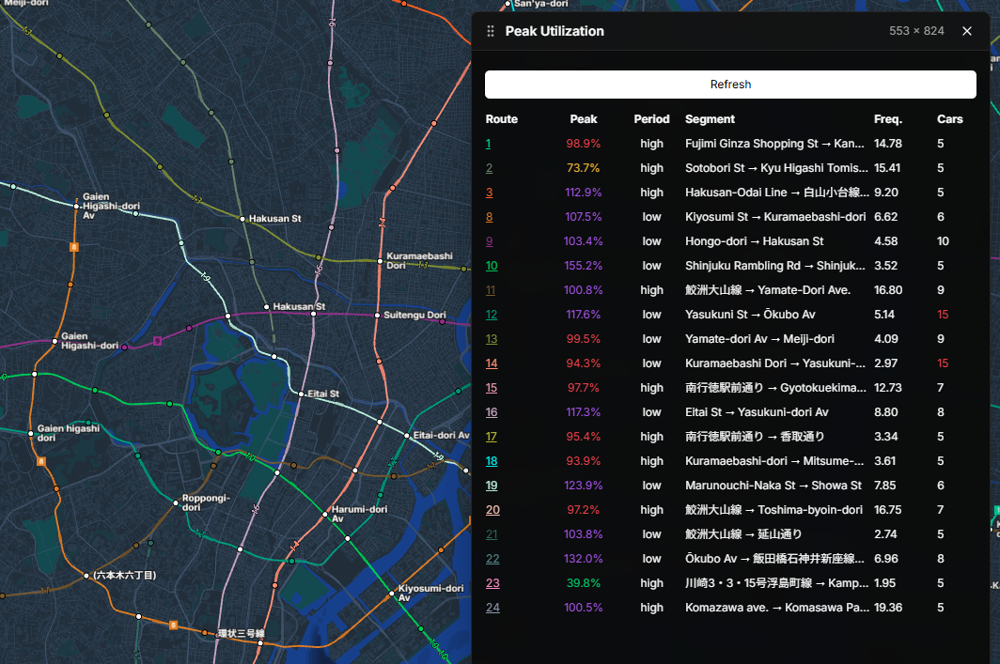
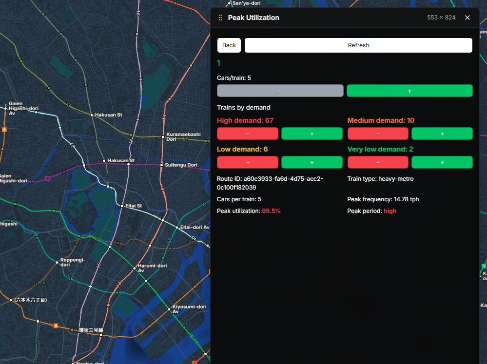

# Peak Utilization

A Subway Builder mod that displays route capacity utilization and lets you adjust train schedules by demand level.

**Author:** [HaguBian](https://github.com/HaguBian)

All original mod code is authored by HaguBian.

## Features

- Dashboard showing each route's highest utilization, peak period, bottleneck segment, frequency, and cars per train.
- Select a route name to view route details and make adjustments:
  - Add or remove cars per train in increments defined by the train type. Buttons are disabled when the next step would exceed the minimum or maximum.
  - Add or remove trains for each demand level: High, Medium, Low, and Very Low. Demand train counts can be reduced to 0, but not below 0.
- Automatically loads data when the mod initializes and when a game is loaded. Use **Refresh** to update immediately.
- Automatically refreshes data at most every 10 in-game minutes while the game is running.
- Sort dashboard columns by selecting their headers. Names consisting only of numbers appear before names containing letters. Numeric sorting is natural, e.g. `2` before `10` and `Line 2` before `Line 10`.

## Dashboard Reference

| Column | Description |
| --- | --- |
| Route | Route name. Select the name to open Route Info. |
| Peak | Utilization percentage at the most congested segment during the analyzed peak period. |
| Period | Demand level corresponding to the peak period. |
| Segment | The segment between two stations with the highest utilization during that period. |
| Freq. | Train frequency during the peak period, in trains per hour. |
| Cars | Number of cars per train. |

**Peak utilization** colors: green below 70%, yellow from 70%, orange from 80%, red from 90%, and purple above 100%. Demand colors: High is red, Medium is orange, Low is yellow, and Very Low is green.

## Screenshots

### Dashboard



### Route Info



## Installation

### Install from GitHub Releases

1. Open [Peak Utilization releases](https://github.com/HaguBian/subwaybuilder-peak-utilization/releases/latest) and download `subwaybuilder-peak-utilization-v1.0.2.zip`.
2. Extract `index.js` and `manifest.json` directly into the mod folder for your platform:

   - Windows: `%APPDATA%\metro-maker4\mods\subwaybuilder-peak-utilization\`
   - macOS: `~/Library/Application Support/metro-maker4/mods/subwaybuilder-peak-utilization/`
   - Linux: `~/.config/metro-maker4/mods/subwaybuilder-peak-utilization/`

   Create the mod folder if it does not exist. Make sure the two files are directly inside it, not inside an extra nested folder.
3. Start Subway Builder and enable **Peak Utilization** under **Settings > Mods**.

### Build from source

For development, install Node.js and pnpm, then run:

```bash
pnpm install
pnpm build
```

The built mod is written to `dist/`. Use `pnpm dev:link` to link it into the game's mods folder.

## Development

| Command | Description |
| --- | --- |
| `pnpm build` | Build the mod into `dist/`. |
| `pnpm typecheck` | Run the TypeScript type checker. |
| `pnpm dev:link` | Link `dist/` to the game's mods folder. |
| `pnpm dev:unlink` | Remove the link created by `dev:link`. |
| `pnpm dev` | Run the build watcher and launch the game; logs are saved to `debug/latest.log`. |

## Publishing a GitHub Release

1. Commit and push the release changes to [HaguBian/subwaybuilder-peak-utilization](https://github.com/HaguBian/subwaybuilder-peak-utilization).
2. Set the release version in `manifest.json` and commit the change. Use the same version for the Git tag and release asset names.
3. Run the checks and build:

   ```bash
   pnpm typecheck
   pnpm build
   ```

4. Package the mod files into a ZIP with no enclosing `dist` directory. Also upload the same `manifest.json` as a separate release asset, as required by the Registry. For PowerShell:

   ```powershell
   Compress-Archive -Path dist\index.js, dist\manifest.json -DestinationPath release\subwaybuilder-peak-utilization-v1.0.2.zip -Force
   Copy-Item dist\manifest.json release\manifest.json -Force
   ```

   Replace `1.0.2` with the version being released.
5. On GitHub, open **Releases > Draft a new release**, create a tag such as `v1.0.2` from the commit containing the release changes, and set the release title to **Peak Utilization v1.0.2**.
6. Attach both `subwaybuilder-peak-utilization-v1.0.2.zip` and the standalone `manifest.json`, add release notes, and publish the release.

## Submit to the Registry

After publishing the GitHub release:

1. Sign in to GitHub as **HaguBian** and open the Registry's [Publish New Mod form](https://github.com/Subway-Builder-Modded/registry/issues/new?template=publish-mod.yml).
2. Submit the following listing details:
   - **Mod ID:** `subwaybuilder-peak-utilization` (must match `manifest.json`; this ID is permanent).
   - **Display Name:** `Peak Utilization`
   - **Description:** `Displays route capacity utilization and lets players adjust train schedules and cars per train.`
   - **Tags:** `gameplay`, `qol`, `ui`
   - **Source URL:** `https://github.com/HaguBian/subwaybuilder-peak-utilization`
   - **Update Type:** `GitHub Releases`
   - **GitHub Repository:** `HaguBian/subwaybuilder-peak-utilization`
   - **Gallery Images:**
     - Dashboard: `https://raw.githubusercontent.com/HaguBian/subwaybuilder-peak-utilization/main/doc/image/peak-utilization-dashboard.png`
     - Route Info: `https://raw.githubusercontent.com/HaguBian/subwaybuilder-peak-utilization/main/doc/image/route-info.png`
   - Leave **Collaborators** and **Caretaker** empty; submit from HaguBian's account so the listing is attributed to the author.
3. Confirm that you are the author or have permission to publish the mod and accept the platform Terms of Service.
4. Submit the form and wait for Registry maintainer review. Fix any validation errors on the issue and comment `revalidate` to retry.

The Registry requires the mod ZIP and the matching standalone `manifest.json` as separate assets in the GitHub release. The manifest must include a valid `subway-builder` compatibility range and its `id` must match the Registry Mod ID.

## Notes

- The mod requires Subway Builder Modding API v1.0.0 and is marked compatible with game versions up to 1.7.2. Other API versions may not be compatible.
- Utilization calculations use completed commute data, train schedule settings, and train type capacity. Routes with insufficient data may display `N/A`.
- Changes to cars per train and demand schedules are written directly to the route configuration in the game.
